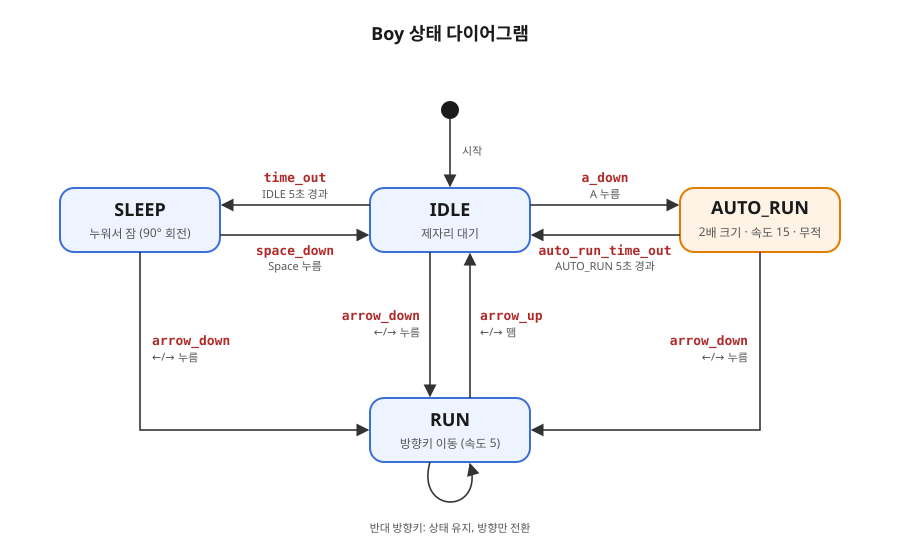

# Drill 12 개발 문서

## 1. 개요

pico2d로 만드는 2D 캐릭터 조작 프로그램이다. 잔디 위에 소년이 서 있고, 키 입력과 시간 경과에 따라
소년의 상태(대기, 잠, 달리기, 자동 런)가 바뀐다. 상태 관리는 `transitions` 라이브러리의
상태 머신(`Machine`)으로 구현한다.

## 2. 개발 환경

| 항목 | 내용 |
| --- | --- |
| 언어 | Python 3.14 |
| 라이브러리 | `pico2d`, `transitions` |
| 설치 | `pip install pico2d transitions` |
| 실행 | `python main.py` |

## 3. 파일 구성

| 파일 | 역할 |
| --- | --- |
| `main.py` | 캔버스 생성, 게임 루프, 월드(객체 목록) 관리, 이벤트 분배 |
| `grass.py` | 바닥 잔디 객체 `Grass` |
| `boy.py` | 소년 객체 `Boy`와 상태 머신, 자동 런 상태 `AutoRun` |
| `grass.png` | 잔디 이미지 |
| `animation_sheet.png` | 소년 스프라이트 시트 (800×400, 프레임 100×100, 8프레임 × 4줄) |

### 스프라이트 시트 줄 배치 (`animation_sheet.png`)

| source_y | 내용 |
| --- | --- |
| 300 | 오른쪽 보고 대기 |
| 200 | 왼쪽 보고 대기 |
| 100 | 오른쪽으로 달리기 |
| 0 | 왼쪽으로 달리기 |

## 4. 게임 구조

```
open_canvas()
reset_world()          # 월드에 Grass, Boy 추가
while running:
    handle_events()    # 종료 처리, 나머지 이벤트는 boy.handle_event()로 전달
    update_world()     # 월드의 모든 객체 update()
    render_world()     # 화면 지우고 모든 객체 draw()
    delay(0.01)
close_canvas()
```

월드의 모든 객체는 `update()`와 `draw()`를 가진다.

## 5. 소년 상태 설계

### 상태

| 상태 | 설명 |
| --- | --- |
| `IDLE` | 제자리에서 바라보는 방향으로 대기 애니메이션 |
| `SLEEP` | IDLE이 5초 지속되면 누워서(90도 회전) 잠듦 |
| `RUN` | 방향키를 누르는 동안 좌우로 이동 (속도 5, 화면 밖으로 나가지 않음) |
| `AUTO_RUN` | A키로 시작. 5초 동안 2배 크기로 빠르게(속도 15) 좌우 왕복, 무적 상태 |

### 상태 전이표

| 트리거 | 이벤트 | 출발 상태 | 도착 상태 |
| --- | --- | --- | --- |
| `time_out` | IDLE 5초 경과 | IDLE | SLEEP |
| `space_down` | 스페이스 누름 | SLEEP | IDLE |
| `arrow_down` | ←/→ 누름 | IDLE, SLEEP, AUTO_RUN | RUN |
| `arrow_up` | ←/→ 뗌 | RUN | IDLE |
| `a_down` | A 누름 | IDLE | AUTO_RUN |
| `auto_run_time_out` | AUTO_RUN 5초 경과 | AUTO_RUN | IDLE |

### 상태 다이어그램



- RUN 중에 반대 방향키를 누르면 상태 전이 없이 방향만 바꾼다.
- 초기 상태(IDLE)는 `on_enter` 콜백이 호출되지 않으므로 생성자에서 직접 대기 타이머를 시작한다.

## 6. 구현 단계 (커밋 계획)

1. 개발 문서 작성
2. `.gitignore` 추가
3. 게임 루프와 월드 구조 구현 (`main.py`)
4. 잔디(`Grass`) 객체 추가
5. 소년(`Boy`) 객체와 IDLE 애니메이션 구현
6. `transitions` 상태 머신 도입 및 SLEEP 상태 구현
7. 방향키로 RUN 상태 구현
8. A키로 AUTO_RUN(자동 무적 런) 상태 구현
